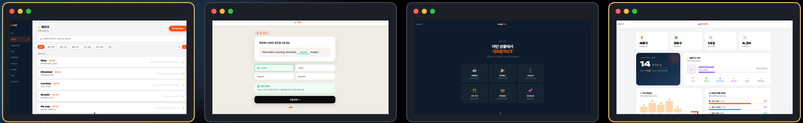
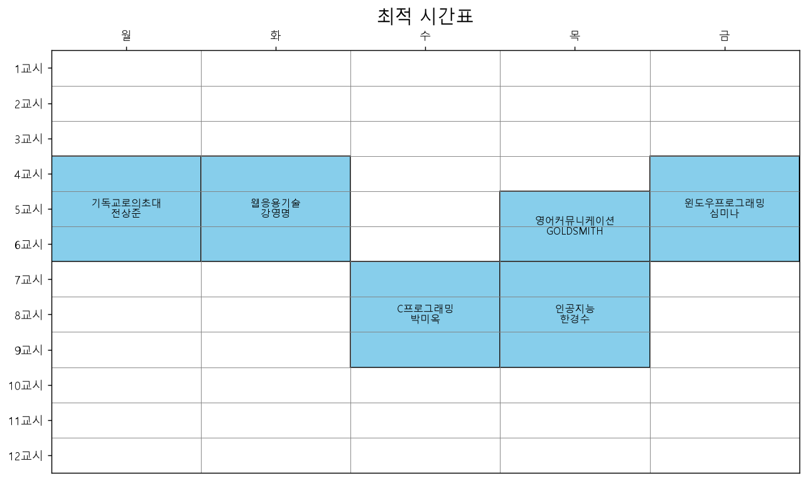

  
    
  
    
  

## 🛠 Tech Stack

  

## 📂 Projects

| 프로젝트 | 한 줄 소개 | 형태 |
|---|---|---|
| [**SongRush**](#songrush) | 같은 순간에 같은 곡을 듣고 애니 제목을 맞히는 멀티플레이 게임 | 개인 · 운영 중 |
| [**English INSSA**](#english-inssa) | 사전 슬랭 3만 개에서 실제로 쓰이는 384개를 골라낸 데이터 파이프라인 | 졸업 작품 · 파이프라인 담당 |
| [**이음 옥션**](#ieum-auction) | 취약계층이 만든 상품을 경매로 파는 사회적 가치 플랫폼 | 팀 4명 · 팀장 |
| [**시간표 최적화**](#schedule) | 담금질 기법으로 공강 적은 시간표 자동 생성 | 개인 |

### SongRush

 

친구들과 노래 맞히기를 하면 누가 먼저 들었는지 늘 애매했습니다. 그래서 모두가 같은 순간에 같은 곡을 듣고, 서버가 먼저 맞힌 사람을 가리는 애니 OP/ED 게임을 만들었습니다. 기획부터 AWS 배포·운영까지 혼자 했고, 코드는 제가 설계한 AI 에이전트 팀이 쓰고 저는 결정과 검증 구조를 맡았습니다.

주로 고민한 것: 지연이 다른 기기들을 같은 순간에 재생시키기, 거의 동시에 들어온 정답 판정, 곡마다 길어지던 로딩

`Spring Boot WebSocket` `React` `Flutter` `AWS` `Claude Code` · 개인 · 2026.11 ~ 운영 중

<a href="#projects">↑ 목록으로</a>

---

### English INSSA 슬랭 데이터 파이프라인

팀 졸업 작품인 영어 슬랭 학습 서비스에서 데이터 파이프라인을 혼자 맡았습니다. 사전에 실린 슬랭 3만여 개 중 실제로 쓰이는 384개를 골라 서비스에 넣었고, 위 화면들이 그 데이터로 돌아갑니다.

주로 고민한 것: 메모리에 올릴 수 없는 덤프 처리, LLM 호출 비용, LLM 결과를 그대로 믿지 않는 법

`Python` `OpenAI API` `pytest` `GitHub Actions` · 졸업 작품 · 2026.03 ~ 06

<a href="#projects">↑ 목록으로</a>

---

### 이음 옥션

취약계층이 만든 상품을 협약 기관과 함께 경매로 파는 서비스입니다. 4인 팀의 팀장으로 기획과 스프린트를 이끌었고, 백엔드에서는 서버 재시작 시 경매 종료 복구와 관리자 API를 맡았습니다.

주로 고민한 것: 시작 시각 없이 첫 입찰부터 흐르는 경매 규칙, 동시에 들어온 입찰의 순서

`Spring Boot` `JPA` `Redis` `SSE` `React` · 팀 4명 · 2026.09 ~ 10

<a href="#projects">↑ 목록으로</a>

---

### 시간표 최적화

15~18학점 안에서 공강은 줄이고 하루 수업은 고르게 되는 시간표를 담금질 기법으로 찾는 프로그램입니다. 위 그림은 실제 강의 데이터로 돌린 결과입니다(교수명은 가렸습니다).

`Python` · 개인

<a href="#projects">↑ 목록으로</a>

---

### 그 밖의 프로젝트

| 프로젝트 | 설명 | 기술 |
|---|---|---|
| [AI_Professor](https://github.com/kimdoodoo12/AI_Professor) | 강의 자료(PDF·이미지) 업로드 → OCR → 요약 → OX·객관식 퀴즈 생성 | Django, Tesseract, OpenCV, OpenAI |
| [SwingCalendar](https://github.com/kimdoodoo12/SwingCalendar) | 일정 관리 캘린더 + ODsay API 지하철 경로 안내 | Java Swing |

## 📊 Activity

<picture>
  <source media="(prefers-color-scheme: dark)" srcset="https://raw.githubusercontent.com/kimdoodoo12/kimdoodoo12/output/github-snake-dark.svg" />
  
</picture>
