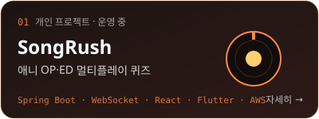
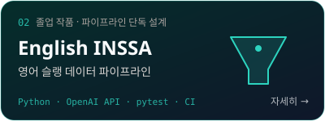
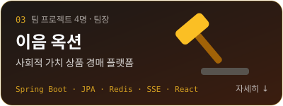
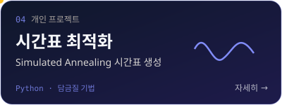

  
    
  
    
  

## 🛠 Tech Stack

  

## 📂 Projects

  
  
  
  

카드를 누르면 프로젝트 소개와 저장소 링크로 이동합니다.

### 그 밖의 프로젝트

| 프로젝트 | 설명 | 기술 |
|---|---|---|
| [AI_Professor](https://github.com/kimdoodoo12/AI_Professor) | 강의 자료(PDF·이미지) 업로드 → OCR → 요약 → OX·객관식 퀴즈 생성 | Django, Tesseract, OpenCV, OpenAI |
| [SwingCalendar](https://github.com/kimdoodoo12/SwingCalendar) | 일정 관리 캘린더 + ODsay API 지하철 경로 안내 | Java Swing |

## 📊 Activity

<picture>
  <source media="(prefers-color-scheme: dark)" srcset="https://raw.githubusercontent.com/kimdoodoo12/kimdoodoo12/output/github-snake-dark.svg" />
  
</picture>
