  
    
  
    
  

## 🛠 Tech Stack

  

## 📂 Projects

### 1. English INSSA Slang Data Pipeline · 졸업 작품

> 사전에 등록된 슬랭 중 **실제로 쓰이는 것만** 골라 영어 학습 서비스용 데이터셋으로 만드는 파이프라인
> 팀 졸업 작품 중 **`data_pipeline/` 전체를 단독 설계·구현**

| | |
|---|---|
| **문제** | Wiktionary 슬랭 목록에는 아무도 쓰지 않는 단어가 섞여 있어 그대로 서비스에 쓸 수 없음 |
| **해결** | Reddit 댓글 2개월치로 실사용 빈도 측정 → 문맥 샘플링 → LLM 판정 → 우선순위 점수 → 사람 검수 |
| **결과** | 후보 **6,423 → 3,293 → 384개** 서비스 승인 |

**설계 포인트**
- **대용량 스트리밍** — bz2(Wiktionary)·zstd(Reddit) 덤프를 메모리에 올리지 않고 스트리밍 처리
- **Reservoir Sampling** — 한 번의 순회로 편향 없는 문맥 표본 추출, 시드 고정으로 재현 가능
- **LLM 조기 종료** — 첫 60개 문맥에서 슬랭 판정이 0건이면 즉시 탈락 → 후보의 48%(3,085개)를 추가 호출 없이 정리
  예: `cap`은 문맥 60개가 전부 *market cap*, *salary cap*이라 탈락
- **크래시 안전** — 단어 단위로 결과를 저장해서 중단돼도 이어서 재개
- **품질 게이트** — 품질 리포트로 승인 데이터의 카테고리 불일치 **54.4%**를 발견해 전체 재분류·동기화. `pytest` 43개 + CI에서 리포트 실패 시 머지 차단

`Python 3.12` `OpenAI API (gpt-4.1-nano, JSON schema)` `zstandard` `mwparserfromhell` `pytest` `GitHub Actions`

→ [english-inssa-data-pipeline](https://github.com/kimdoodoo12/english-inssa-data-pipeline)

---

### 2. 이음 옥션 · 사회적 가치 상품 경매 플랫폼

> 장애인·사회적 약자가 만든 상품을 기관과 협약해 경매로 판매하는 서비스
> **4인 팀 프로젝트 · 팀장**

| | |
|---|---|
| **내 역할** | **팀장 · 프로젝트 총괄** — 기획, 일정·스프린트 관리, 업무 분배 |
| **경매 규칙** | 시작 시각 없이 *첫 입찰 순간부터* 24시간 카운트다운, 종료 시 최고 입찰자 낙찰 |
| **팀 아키텍처** | SSE로 현재가 실시간 방송 · 경매별 입찰 큐로 동시 입찰 순서 보장 · JWT + Redis 리프레시 토큰 |

`Java 17` `Spring Boot` `JPA` `Redis` `React` `MySQL`

→ [social-auction-platform](https://github.com/kimdoodoo12/social-auction-platform)

---

### 3. 대학 시간표 최적화 · Simulated Annealing

> 15~18학점 제약 안에서 **공강은 줄이고 하루 수업은 고르게** 배치하는 시간표 자동 생성

- 겹치지 않는 랜덤 시간표에서 시작해 강의 하나를 빼고 충돌 없는 강의로 교체하며 탐색
- 온도가 높을 때는 나쁜 해도 확률적으로 받아들여 **지역 최솟값 탈출**
- 위 애니메이션의 공 경로도 실제 담금질 알고리즘을 돌려 나온 경로

`Python` → [schedule_optimization](https://github.com/kimdoodoo12/schedule_optimization)

---

### 그 밖의 프로젝트

| 프로젝트 | 설명 | 기술 |
|---|---|---|
| [AI_Professor](https://github.com/kimdoodoo12/AI_Professor) | 강의 자료(PDF·이미지) 업로드 → OCR → 요약 → OX·객관식 퀴즈 생성 | Django, Tesseract, OpenCV, OpenAI |
| [SwingCalendar](https://github.com/kimdoodoo12/SwingCalendar) | 일정 관리 캘린더 + ODsay API 지하철 경로 안내 | Java Swing |

## 📊 Activity

<picture>
  <source media="(prefers-color-scheme: dark)" srcset="https://raw.githubusercontent.com/kimdoodoo12/kimdoodoo12/output/github-snake-dark.svg" />
  
</picture>
