  
    
  
    
  

## 🛠 Tech Stack

  

## 📂 Projects

| 프로젝트 | 한 줄 소개 | 형태 |
|---|---|---|
| [**SongRush**](#songrush) | 같은 순간에 같은 곡을 듣고 애니 제목을 맞히는 멀티플레이 게임 | 개인 · 운영 중 |
| [**English INSSA**](#english-inssa) | 사전 슬랭 3만 개에서 실제로 쓰이는 384개를 골라낸 데이터 파이프라인 | 졸업 작품 · 파이프라인 담당 |
| [**이음 옥션**](#ieum-auction) | 취약계층이 만든 상품을 경매로 파는 사회적 가치 플랫폼 | 팀 4명 · 팀장 |
| [**시간표 최적화**](#schedule) | 담금질 기법으로 공강 적은 시간표 자동 생성 | 개인 |

### 1. SongRush · 애니 OP/ED 멀티플레이 퀴즈

 

> 최대 8명이 같은 순간에 같은 곡을 듣고 애니 제목을 먼저 맞히는 실시간 게임 · [animeopguessr.com](https://animeopguessr.com)
> **1인 개발 · AI 에이전트 팀(구현·검증·비평)을 직접 설계해 운영 배포까지**

| &nbsp;&nbsp;&nbsp;&nbsp;&nbsp;&nbsp;&nbsp;&nbsp; | |
|---|---|
| **문제** | 기기마다 네트워크·소리 출력 지연이 달라, 그냥 틀면 먼저 듣는 사람이 생기고 동시 정답의 승자가 갈림 |
| **해결** | 서버가 시작 시각(`startAt`)을 정하고 각 기기는 오디오 엔진 시계에 예약 · 정답 판정은 방마다 단일 스레드에서 서버 도착 순 |
| **결과** | 재생 시작 오차 **2.5ms** · 동시 정답도 **1명만** 득점 · CloudFront 경유와 미리 받기로 음원 대기 **9.7초 → 2.4초** |

`Java 17` `Spring Boot WebSocket` `React` `Flutter` `AWS EC2·S3·CloudFront` `Docker` `GitHub Actions` `Claude Code`

<a href="#projects">↑ 프로젝트 목록으로</a>

---

### 2. English INSSA Slang Data Pipeline · 졸업 작품

> 사전에 등록된 슬랭 중 **실제로 쓰이는 것만** 골라 영어 학습 서비스용 데이터셋으로 만드는 파이프라인
> 팀 졸업 작품 중 **`data_pipeline/` 전체를 단독 설계·구현**

| &nbsp;&nbsp;&nbsp;&nbsp;&nbsp;&nbsp;&nbsp;&nbsp; | |
|---|---|
| **문제** | Wiktionary 슬랭 목록에는 아무도 쓰지 않는 단어가 섞여 있어 그대로 서비스에 쓸 수 없음 |
| **해결** | Wiktionary 슬랭 라벨 추출 → Reddit 댓글 2개월치로 사용량 점수화 → 문맥 샘플링 → LLM 판정 → 우선순위 점수 → 사람 검수 |
| **결과** | 슬랭 표제어 **33,009** → 사용량 점수화 **6,423** → LLM 판정 **3,293** → 사람 검수 **384개** 서비스 승인 |

**설계 포인트**
- **대용량 스트리밍** — bz2(Wiktionary)·zstd(Reddit) 덤프를 메모리에 올리지 않고 스트리밍 처리
- **사용량 점수화(직접 설계)** — 후보를 n-gram 인덱스로 Reddit 댓글 전체에 한 번에 대조해 댓글 수·등장 subreddit 수를 세고, 로그 가중합(0.6/0.4)으로 점수화해 33,009개를 6,423개로 압축. 컷은 실제 쓰이는 슬랭들의 점수를 기준으로 설정
- **Reservoir Sampling** — 한 번의 순회로 단어별 문맥 표본 추출, 시드 고정으로 재현 가능
- **LLM 조기 종료** — 첫 60개 문맥에서 슬랭 판정이 0건이면 즉시 탈락 → 후보의 48%(3,085개)를 추가 호출 없이 정리
  예: `money`는 사전에 슬랭 뜻이 있지만 60개 문맥에서 슬랭 용법이 0건이라 탈락
- **진행분 저장** — LLM 판정 결과를 단어 단위로 즉시 저장하고, 재실행 시 이미 탈락한 단어는 다시 판정하지 않음
- **품질 게이트** — 품질 리포트로 승인 데이터의 카테고리 불일치 <b>54.4%</b>를 발견해 전체 재분류·동기화. `pytest` 43개 + CI에서 리포트 실패 시 머지 차단

`Python 3.12` `OpenAI API (gpt-4.1-nano, JSON mode)` `zstandard` `mwparserfromhell` `pytest` `GitHub Actions`

<a href="#projects">↑ 프로젝트 목록으로</a>

---

### 3. 이음 옥션 · 사회적 가치 상품 경매 플랫폼

> 장애인·사회적 약자가 만든 상품을 기관과 협약해 경매로 판매하는 서비스
> **4인 팀 프로젝트 · 팀장**

| &nbsp;&nbsp;&nbsp;&nbsp;&nbsp;&nbsp;&nbsp;&nbsp; | |
|---|---|
| **내 역할** | **팀장 · 프로젝트 총괄** — 기획, 일정·스프린트 관리, 업무 분배 |
| **경매 규칙** | 시작 시각 없이 *첫 입찰 순간부터* 24시간 카운트다운, 종료 시 최고 입찰자 낙찰 |
| **팀 아키텍처** | SSE로 현재가 실시간 방송 · 경매별 입찰 큐로 동시 입찰 순서 보장 · JWT + Redis 리프레시 토큰 |

`Java 17` `Spring Boot` `JPA` `Redis` `React` `MySQL`

<a href="#projects">↑ 프로젝트 목록으로</a>

---

### 4. 대학 시간표 최적화 · Simulated Annealing

> 15~18학점 제약 안에서 **공강은 줄이고 하루 수업은 고르게** 배치하는 시간표 자동 생성

- 겹치지 않는 랜덤 시간표에서 시작해 강의 하나를 빼고 충돌 없는 강의로 교체하며 탐색
- 온도가 높을 때는 나쁜 해도 확률적으로 받아들여 **지역 최솟값 탈출**
- 위 그림은 저장소의 강의 데이터로 프로그램을 실제로 돌려 나온 결과 시간표

`Python`

<a href="#projects">↑ 프로젝트 목록으로</a>

---

### 그 밖의 프로젝트

| 프로젝트 | 설명 | 기술 |
|---|---|---|
| [AI_Professor](https://github.com/kimdoodoo12/AI_Professor) | 강의 자료(PDF·이미지) 업로드 → OCR → 요약 → OX·객관식 퀴즈 생성 | Django, Tesseract, OpenCV, OpenAI |
| [SwingCalendar](https://github.com/kimdoodoo12/SwingCalendar) | 일정 관리 캘린더 + ODsay API 지하철 경로 안내 | Java Swing |

## 📊 Activity

<picture>
  <source media="(prefers-color-scheme: dark)" srcset="https://raw.githubusercontent.com/kimdoodoo12/kimdoodoo12/output/github-snake-dark.svg" />
  
</picture>
