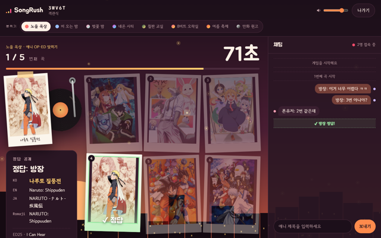
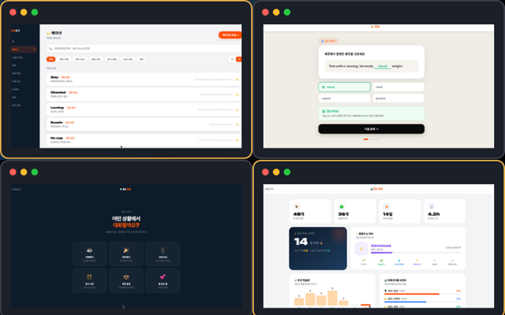
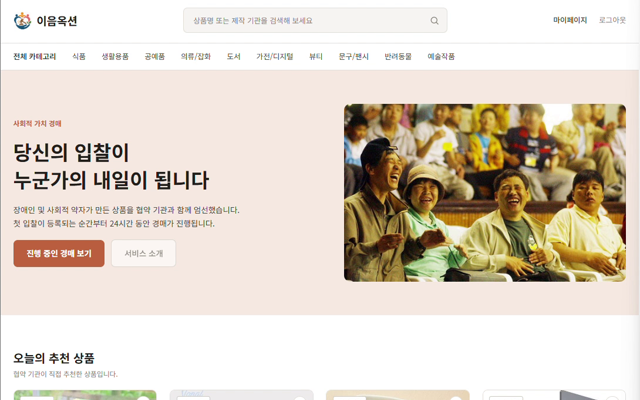
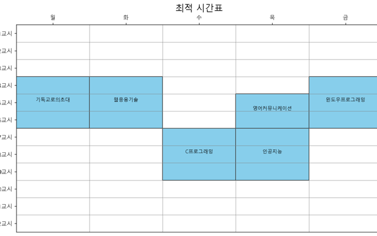

  
    
  
    
  

## 🛠 Tech Stack

  

## 📂 Projects

<table>
<tr>
<td width="50%" valign="top">
<h3><a href="https://github.com/kimdoodoo12/SongRushApp">SongRush</a></h3>
개인 · 2026.11~ 운영 중  

같은 순간에 같은 곡을 듣고 애니 제목을 먼저 맞히는 멀티플레이 게임. AI 에이전트 팀을 설계해 혼자 운영 배포까지

<code>Spring Boot</code> <code>WebSocket</code> <code>React</code> <code>Flutter</code> <code>AWS</code>

📂 <a href="https://github.com/kimdoodoo12/SongRushApp">저장소</a> &nbsp;·&nbsp; 🎮 <a href="https://animeopguessr.com">플레이하기</a>

</td>
<td width="50%" valign="top">
<h3><a href="https://github.com/kimdoodoo12/english-inssa-data-pipeline">English INSSA</a></h3>
졸업 작품 · 2026.03~06  

사전 슬랭 3만여 개 중 실제로 쓰이는 384개를 골라낸 데이터 파이프라인. 팀에서 파이프라인 전체 담당

<code>Python</code> <code>OpenAI API</code> <code>pytest</code> <code>GitHub Actions</code>

📂 <a href="https://github.com/kimdoodoo12/english-inssa-data-pipeline">저장소</a>

</td>
</tr>
<tr>
<td width="50%" valign="top">
<h3><a href="https://github.com/kimdoodoo12/social-auction-platform">이음 옥션</a></h3>
팀 4명 · 2026.09~10  

취약계층이 만든 상품을 경매로 잇는 사회적 가치 플랫폼. 팀장, 경매 종료 복구·관리자 API 담당

<code>Spring Boot</code> <code>JPA</code> <code>Redis</code> <code>SSE</code> <code>React</code>

📂 <a href="https://github.com/kimdoodoo12/social-auction-platform">저장소</a>

</td>
<td width="50%" valign="top">
<h3><a href="https://github.com/kimdoodoo12/schedule_optimization">시간표 최적화</a></h3>
개인  

15~18학점 안에서 공강을 줄이는 시간표를 담금질 기법으로 찾는 프로그램

<code>Python</code> <code>Simulated Annealing</code>

📂 <a href="https://github.com/kimdoodoo12/schedule_optimization">저장소</a>

</td>
</tr>
</table>

### 그 밖의 프로젝트

| 프로젝트 | 설명 | 기술 |
|---|---|---|
| [AI_Professor](https://github.com/kimdoodoo12/AI_Professor) | 강의 자료(PDF·이미지) 업로드 → OCR → 요약 → OX·객관식 퀴즈 생성 | Django, Tesseract, OpenCV, OpenAI |
| [SwingCalendar](https://github.com/kimdoodoo12/SwingCalendar) | 일정 관리 캘린더 + ODsay API 지하철 경로 안내 | Java Swing |

## 📊 Activity

<picture>
  <source media="(prefers-color-scheme: dark)" srcset="https://raw.githubusercontent.com/kimdoodoo12/kimdoodoo12/output/github-snake-dark.svg" />
  
</picture>
