# English INSSA Slang Data Pipeline · 졸업 작품

> 사전에 등록된 슬랭 중 **실제로 쓰이는 것만** 골라 영어 학습 서비스용 데이터셋으로 만드는 파이프라인
> 팀 졸업 작품 중 **`data_pipeline/` 전체를 단독 설계·구현**

| | |
|---|---|
| **문제** | Wiktionary 슬랭 목록에는 아무도 쓰지 않는 단어가 섞여 있어 그대로 서비스에 쓸 수 없음 |
| **해결** | Wiktionary 슬랭 라벨 추출 → Reddit 댓글 2개월치로 사용량 점수화 → 문맥 샘플링 → LLM 판정 → 우선순위 점수 → 사람 검수 |
| **결과** | 슬랭 표제어 **33,009** → 사용량 점수화 **6,423** → LLM 판정 **3,293** → 사람 검수 **384개** 서비스 승인 |

**설계 포인트**
- **대용량 스트리밍** — bz2(Wiktionary)·zstd(Reddit) 덤프를 메모리에 올리지 않고 스트리밍 처리
- **사용량 점수화(직접 설계)** — 후보를 n-gram 인덱스로 Reddit 댓글 전체에 한 번에 대조해 댓글 수·등장 subreddit 수를 세고, 로그 가중합(0.6/0.4)으로 점수화해 33,009개를 6,423개로 압축. 컷은 실제 쓰이는 슬랭들의 점수를 기준으로 설정
- **Reservoir Sampling** — 한 번의 순회로 단어별 문맥 표본 추출, 시드 고정으로 재현 가능
- **LLM 조기 종료** — 첫 60개 문맥에서 슬랭 판정이 0건이면 즉시 탈락 → 후보의 48%(3,085개)를 추가 호출 없이 정리
  예: `money`는 사전에 슬랭 뜻이 있지만 60개 문맥에서 슬랭 용법이 0건이라 탈락
- **진행분 저장** — LLM 판정 결과를 단어 단위로 즉시 저장하고, 재실행 시 이미 탈락한 단어는 다시 판정하지 않음
- **품질 게이트** — 품질 리포트로 승인 데이터의 카테고리 불일치 **54.4%**를 발견해 전체 재분류·동기화. `pytest` 43개 + CI에서 리포트 실패 시 머지 차단

`Python 3.12` `OpenAI API (gpt-4.1-nano, JSON mode)` `zstandard` `mwparserfromhell` `pytest` `GitHub Actions`

---

[← 프로필로 돌아가기](https://github.com/kimdoodoo12) · [저장소 README 보기](https://github.com/kimdoodoo12/english-inssa-data-pipeline#readme)
