# 대학 시간표 최적화 · Simulated Annealing

> 15~18학점 제약 안에서 **공강은 줄이고 하루 수업은 고르게** 배치하는 시간표 자동 생성

- 겹치지 않는 랜덤 시간표에서 시작해 강의 하나를 빼고 충돌 없는 강의로 교체하며 탐색
- 온도가 높을 때는 나쁜 해도 확률적으로 받아들여 **지역 최솟값 탈출**
- 위 애니메이션의 공 경로도 실제 담금질 알고리즘을 돌려 나온 경로

`Python`

---

[← 프로필로 돌아가기](https://github.com/kimdoodoo12) · [저장소 README 보기](https://github.com/kimdoodoo12/schedule_optimization#readme)
