# SongRush · 애니 OP/ED 멀티플레이 퀴즈

 

> 최대 8명이 같은 순간에 같은 곡을 듣고 애니 제목을 먼저 맞히는 실시간 게임 · [animeopguessr.com](https://animeopguessr.com)
> **1인 개발 · AI 에이전트 팀(구현·검증·비평)을 직접 설계해 운영 배포까지**

| | |
|---|---|
| **문제** | 기기마다 네트워크·소리 출력 지연이 달라, 그냥 틀면 먼저 듣는 사람이 생기고 동시 정답의 승자가 갈림 |
| **해결** | 서버가 시작 시각(`startAt`)을 정하고 각 기기는 오디오 엔진 시계에 예약 · 정답 판정은 방마다 단일 스레드에서 서버 도착 순 |
| **결과** | 재생 시작 오차 **2.5ms** · 동시 정답도 **1명만** 득점 · CloudFront 경유와 미리 받기로 음원 대기 **9.7초 → 2.4초** |

`Java 17` `Spring Boot WebSocket` `React` `Flutter` `AWS EC2·S3·CloudFront` `Docker` `GitHub Actions` `Claude Code`

---

[← 프로필로 돌아가기](https://github.com/kimdoodoo12) · [저장소 README 보기](https://github.com/kimdoodoo12/SongRushApp#readme)
